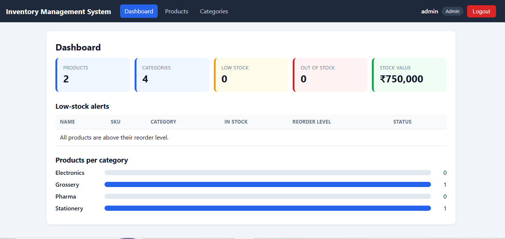

# Inventory Management System

[](https://github.com/shankar850/inventory-management-system/actions/workflows/ci.yml)

A full-stack inventory management application built with **Angular**, **ASP.NET Core Web API**, **Entity Framework Core** and **SQL Server**, with JWT authentication, role-based access and a dashboard with low-stock alerts.

> Status: work in progress. Products, categories, authentication and the dashboard are complete. Stock adjustments, suppliers and orders are planned.

## Screenshots





## Tech stack

- **Frontend:** Angular 22, TypeScript, Reactive Forms, standalone components, signals, responsive CSS
- **Backend:** ASP.NET Core Web API (.NET 10), C#
- **Database:** SQL Server with EF Core (code-first migrations)
- **Security:** JWT bearer authentication, role-based authorization (Admin, Staff), PBKDF2 password hashing
- **Testing:** xUnit
- **API docs:** Swagger (Swashbuckle)
- **CI:** GitHub Actions (builds the API, runs unit tests, builds the Angular client)

## Features

- [x] Products: list, add, edit and delete (API and Angular UI)
- [x] Categories: full CRUD (API and Angular UI); a category that still has products cannot be deleted
- [x] DTOs with validation, and clear `400` and `409` responses (duplicate SKU, invalid category)
- [x] JWT login with roles: Admin can do everything, Staff cannot delete
- [x] Angular route guard, HTTP interceptor and role-based UI
- [x] Dashboard: summary cards, low-stock alerts and a products-per-category chart
- [x] Responsive layout (tables become cards on small screens)
- [x] Unit tests for password hashing, run in CI
- [ ] Stock adjustments with a movement history
- [ ] Suppliers, purchase orders and sales orders
- [ ] Controller tests

## API overview

| Method | Endpoint | Access |
|---|---|---|
| POST | `/api/Auth/login` | Public |
| GET | `/api/Products`, `/api/Products/{id}` | Logged in |
| POST | `/api/Products` | Logged in |
| PUT | `/api/Products/{id}` | Logged in |
| DELETE | `/api/Products/{id}` | **Admin only** |
| GET | `/api/Categories`, `/api/Categories/{id}` | Logged in |
| POST | `/api/Categories` | Logged in |
| PUT | `/api/Categories/{id}` | Logged in |
| DELETE | `/api/Categories/{id}` | **Admin only** (`409` if the category has products) |
| GET | `/api/Dashboard/summary` | Logged in |
| GET | `/api/Dashboard/low-stock` | Logged in |

## Design decisions

- **DTOs** separate the API contract from the database entities and block over-posting.
- **SKU and stock quantity are not editable** through the product update, because stock should change only through business events.
- **Delete is Admin-only** and enforced by the API. The Angular UI also hides the button, but the server is the real guard.
- **The JWT signing key** lives in User Secrets and never in the repository.
- **Passwords** are hashed with PBKDF2 and a random salt.

## Run locally

**Prerequisites:** .NET 10 SDK, SQL Server or LocalDB, Node.js (LTS) and the Angular CLI.

### 1. API

```
git clone https://github.com/shankar850/inventory-management-system.git
cd inventory-management-system/InventoryManagementSystem
dotnet user-secrets set "Jwt:Key" "<a long random secret, at least 32 characters>"
dotnet tool install --global dotnet-ef
dotnet ef database update
dotnet run --launch-profile https
```

Swagger opens at `https://localhost:7292/swagger`.

### 2. Angular client

```
cd inventory-ui
npm install
ng serve
```

Open `http://localhost:4200`.

### 3. Tests

```
dotnet test InventoryManagementSystem.slnx
```

### Demo accounts (Development only)

| Username | Password | Role |
|---|---|---|
| admin | Admin@123 | Admin |
| staff | Staff@123 | Staff |

These users are created automatically in the Development environment only.

## Project structure

```
InventoryManagementSystem/        ASP.NET Core Web API
  Controllers/                    Auth, Products, Categories, Dashboard
  Model/                          Entities (Product, Category, User)
  DTOs/                           Request models with validation
  Data/                           EF Core DbContext
  Helpers/                        Password hashing
  Migrations/                     Database migrations

InventoryManagementSystem.Tests/  xUnit tests

inventory-ui/                     Angular client
  src/app/pages/                  Login, dashboard, product and category screens
  src/app/services/               API and auth services
  src/app/interceptors/           Adds the JWT to requests
  src/app/guards/                 Protects routes
  src/app/models/                 TypeScript interfaces

.github/workflows/ci.yml          CI pipeline
docs/images/                      Screenshots
```

## Roadmap

- Stock adjustments with an audit trail of every stock movement
- Suppliers, purchase orders (stock in) and sales orders (stock out)
- Controller tests with an in-memory database
- Optimistic concurrency, refresh tokens and deployment